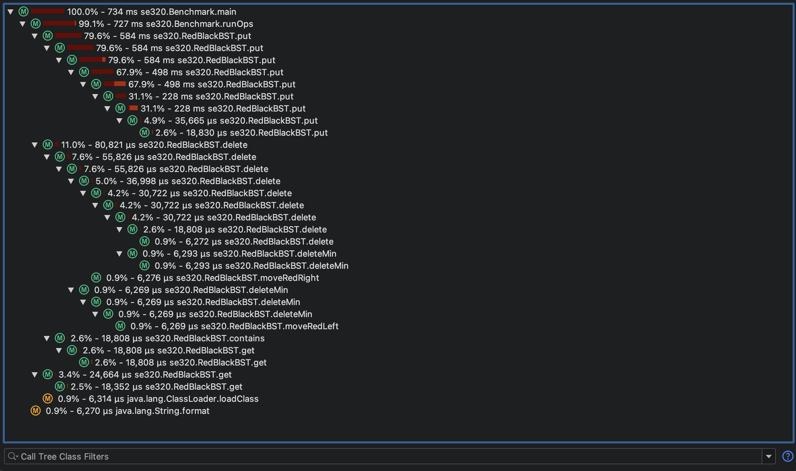
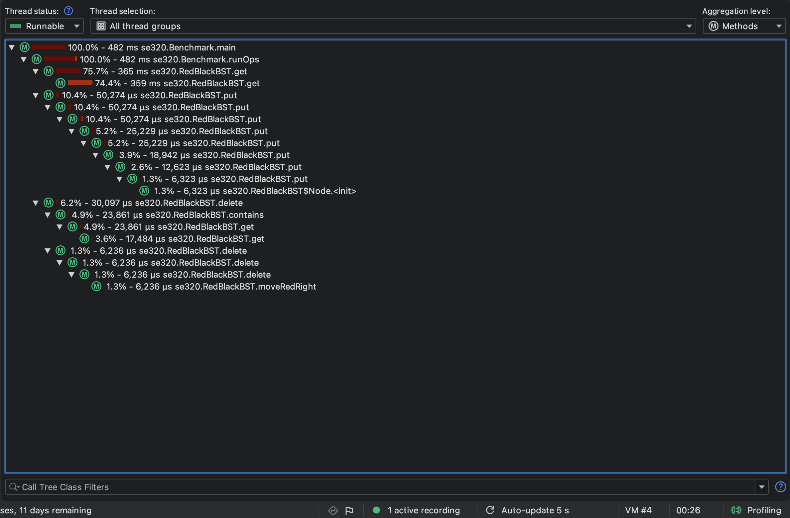
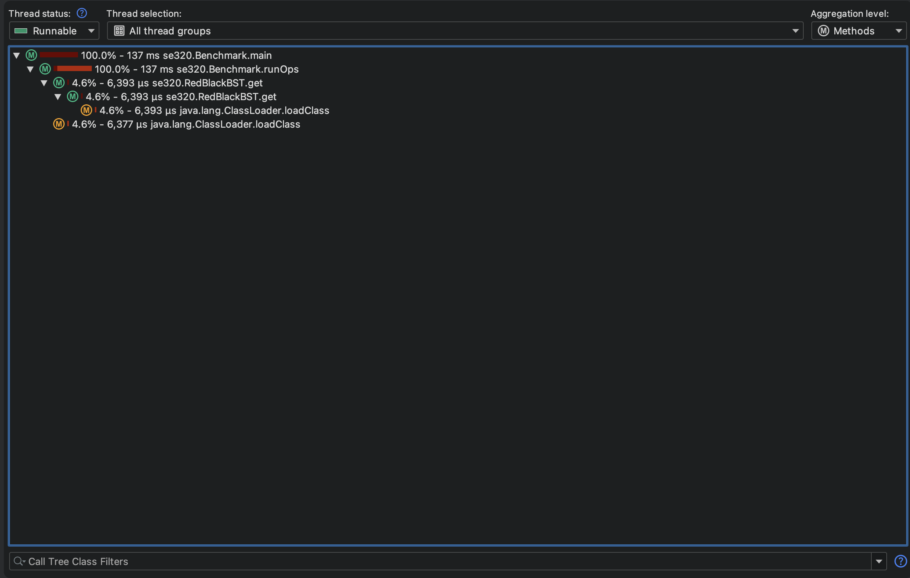

## 1 
The warmup harness is structured this way so that it gives time for the classes to load and optimize frequently used code, so it is excluded from the statistics. Running the test ten more times shows how the timing changes between runs. Each run performs 1,000,000 operations and starts with an empty tree to keep the tests consistent. Operations are chosen randomly based on the selected percentages. System.nanoTime() measures how long each run takes. Results are printed afterward so printing does not affect the measured time.

## 2
Profiles I used
| Workload | Insert | Delete | Read |
|---        |---:|---:|---:|
| Logging | 90% | 5% | 5% |
| Read Heavy | 5% | 5% | 90% |
| Read Only | 0% | 0% | 100% |

## 3
Benchmark results in ns
Results exclude warmup
| Workload | Warmup (ns) | Minimum (ns) | Maximum (ns) | Average (ns) |
|---        |---:       |---:       |---:   |---:       |  
| Logging | 113090458 | 58839083 | 63705959 | 59804070 |
| Read Heavy | 59428459 | 40794000 | 46551209 | 43776679 |
| Read Only | 36653875 | 8073375 | 13832042 | 9402554 |

## 4
Read only has the highest measured throughput, followed by read heavy, and logging last. Profiling show 
that reads do less work than inserts/writes since they don't change or rebalance the tree. The read only test searched
an empty tree which made it extremely fast. 

JProfiler's Results
| Workload | Insert time | Delete time | Read time |
|---       |---:   |---:   |---:|
| Logging | 79.6% | 11.0% | 3.4% |
| Read Heavy | 10.4% | 6.2% | 75.7% |
| Read Only | NA | NA| 4.6% |

In logging, deletions were only 5% of operations but took 11% of the time. In read heavy, insertions were 5% of operations but took 10.4% of the time. This supports the idea that inserts cost more per operation than reads.

Logging Profile

Read Heavy Profile

Read Only Profile

## 5
Yes warmup times were noticeably different. Compared with the average measured times, warmup was approximately:
- Logging: 1.9 times longer
- Read Heavy: 1.36 times longer
- Read Only: 3.9 times longer
The first run includes initial class loading and executes code before the JVM has fully optimized it. Later runs benefit from those optimizations which could explain the significant difference.

## 6
Read only results were misleading because each run starts with an empty tree. Since the read only profile test
never inserts/writes anything into the tree, every lookup returns 'null'. This does not reflect real world examples.

## 7 
Instrumentation based profiling adds tracking work to method calls. Because the benchmark makes millions of short calls, this extra work can make it much slower.

## 8 
One complete run is one request.
Requests/second = 1,000,000,000 ÷ average time in ns
| Workload | Requests/second |
|---       |---:|
| Logging | 16.72 |
| Read Heavy | 22.84 |
| Read Only | 106.35 |

## 9
Each user makes 5 request per minute.
Supported users = requests/second × 12
| Workload | Supported users (Estimate)|
|---       |---:|
| Logging | 200.66 |
| Read Heavy | 274.12 |
| Read Only | 1,276.25 |